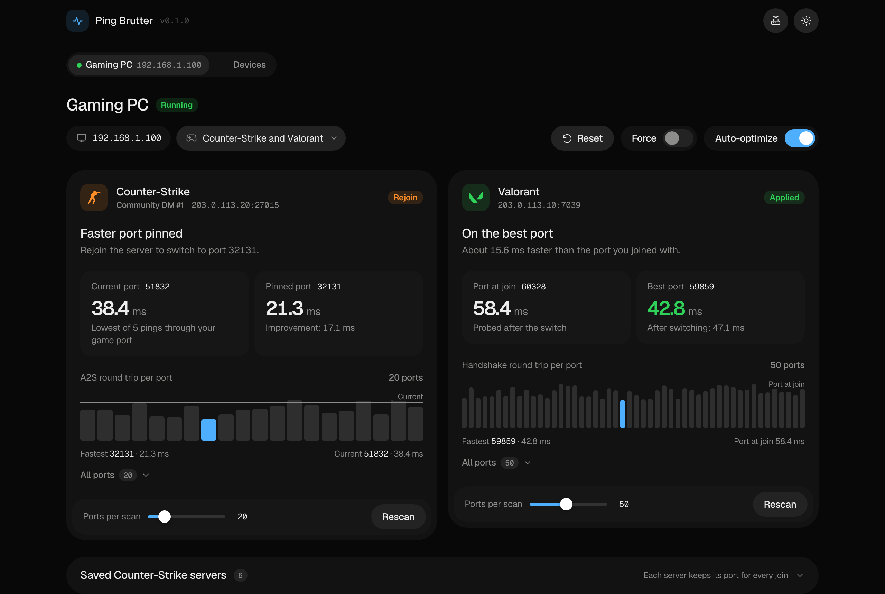
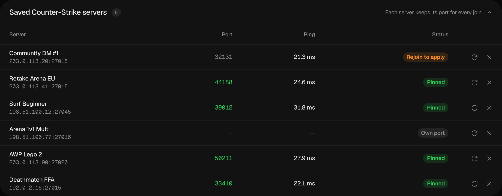

# <picture><source media="(prefers-color-scheme: dark)" srcset="docs/assets/logo-dark.svg"></picture> Ping Brutter

Ping Brutter runs on an OpenWrt router and sends Counter-Strike and Valorant
traffic out of the fastest UDP port.

[](https://openwrt.org/)
[](LICENSE)

[Русская версия](README_ru.md)

<picture>
  <source media="(prefers-color-scheme: light)" srcset="docs/screenshots/dashboard-light.png">
  
</picture>

## Why it helps

Providers often balance UDP across parallel links by port number. Your game can
land on a slow path while another port reaches the same server 10 to 20 ms
faster. Brutter measures dozens of ports from the router and moves your game to
the fastest one. If your provider sends every port the same way, Brutter finds
no gain and leaves your connection alone.

## What it does

- **Counter-Strike** (CS2 and CS:GO, community servers). On a new server Brutter
  measures the A2S round trip from 20 ports and pins the fastest. Rejoin, and
  your game uses that port on this server from then on. A second pinned port
  handles quick rejoins.
- **Valorant.** At the start of a match Brutter probes 50 ports with the game's
  own handshake and moves the live connection to the fastest. Then it measures
  the port you joined with and moves you back if that one was faster.
- **Several devices.** Pick the PCs (and maybe consoles) you play on in the
  dashboard.
- **A 2 ms rule.** Brutter switches only for a gain of 2 ms or more. Turn on
  Force to take the fastest port anyway.
- **Flow offloading.** Brutter keeps the selected devices' UDP out of offload
  and leaves their TCP accelerated.
- **Small.** One static binary: about 3 MB on flash and 15 MB of RAM.

You can change the number of probed ports (5 to 100) per game in the dashboard.



## Install

On the router, as root:

```sh
sh -c "$(wget -qO- https://raw.githubusercontent.com/demyaha/openwrt-brutter/main/scripts/install.sh)"
```

The installer downloads the build for your CPU and checks its SHA256. It adds
`kmod-nf-conntrack-netlink` and turns on conntrack accounting if they are
missing, then starts the `brutter` service and prints the dashboard address,
for example `http://192.168.1.1:1337/`. Open it and pick your devices under
**Devices**.

Run the same command to upgrade. To install a specific release:

```sh
BRUTTER_VERSION=v0.1.0 sh -c "$(wget -qO- https://raw.githubusercontent.com/demyaha/openwrt-brutter/main/scripts/install.sh)"
```

You need OpenWrt 22.03 or newer with firewall4, about 4 MB of free flash and
one of these CPUs: arm64, armv7, armv5, mips, mipsel, x86-64, x86. Brutter is
tested on OpenWrt 25.12.

## Configuration

Brutter works with the defaults. The settings live in `/etc/ping-brutter.json`:

| Key | Default | |
|---|---|---|
| `clients` | `[]` | Gaming devices. The dashboard fills this in. Give them DHCP reservations. |
| `listen` | LAN address | Dashboard address. |
| `port` | `1337` | Dashboard port. |
| `lan_interface` | `br-lan` | LAN bridge. |
| `wan_interface` | default route | WAN device, such as `pppoe-wan` or `wan`. |
| `state_dir` | `/root` | Settings and saved servers. |
| `ram_dir` | `/tmp` | Run-time files. |

Restart after editing: `/etc/init.d/brutter restart`. Logs: `logread -e brutter`.

## Uninstall

```sh
sh -c "$(wget -qO- https://raw.githubusercontent.com/demyaha/openwrt-brutter/main/scripts/uninstall.sh)"
```

Settings and saved servers stay. Add `--purge` to remove them as well:

```sh
sh -c "$(wget -qO- https://raw.githubusercontent.com/demyaha/openwrt-brutter/main/scripts/uninstall.sh)" uninstall --purge
```

## Questions

**Will my ping drop?** Only if your provider routes by port. The dashboard
shows the round trip of every port Brutter tried, so you see the spread
yourself. The number in the game can differ a little because the game adds its
own processing.

**Official Valve matchmaking?** No. Premier and other Valve matches go through
Steam Datagram Relay: your PC connects to a Valve relay, which does not answer
the queries Brutter measures with. Community servers with a direct address work.

**CGNAT, a second router, a VPN?** Brutter has to run on the router that does
your last NAT. A NAT after it can change the port again, and a VPN or proxy
replaces the game's route with its own.

**Is the dashboard protected?** No, any device on your LAN can open it. Brutter
listens on the LAN address; do not forward its port.

## What Brutter changes on the router

It installs `/usr/bin/brutter`, `/etc/init.d/brutter` and
`/etc/ping-brutter.json`, and keeps settings and saved servers in
`/root/ping-brutter-*.json`. At run time it adds nftables tables named
`brutter_*` and removes them when it stops. While devices are selected, it
maintains `/etc/nftables.d/20-brutter.nft` and reloads firewall4 when the list
changes, after `fw4 check` accepts the rules. The uninstall script removes all
of it.

## Building

```sh
go test -race ./...
scripts/build.sh 0.1.0    # every target and SHA256SUMS into dist/
```

A pushed `v*` tag builds a GitHub release.

## Credits

- [Dawnline](https://github.com/tickcount/luci-app-dawnline): the dashboard
  borrows its design.
- [Claude Code](https://claude.com/claude-code)
